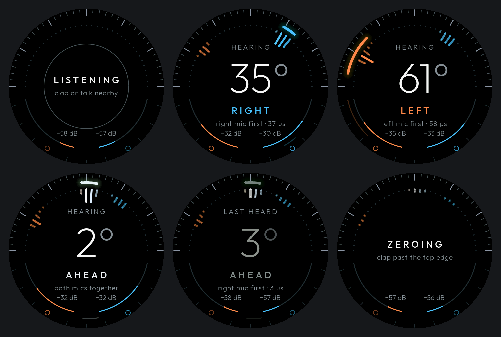

# Sound Compass

Points to a sound using the two microphones on a Waveshare ESP32-S3-Touch-AMOLED-1.75 (466 x 466 round display).



## What it can and can't tell you

Two mics give one angle, from straight ahead (0°) to either side (90°). They can't give distance, and they can't tell front from back. The faint arc in the lower half marks that mirror position.

Hold the board with the USB port at the bottom and the screen facing you, which puts the mics side by side across you. With the cable coming out of the side they sit one above the other, and it can't tell left from right at all.

## Reading the screen

- Colour is the side: warm is left, cool is right, white is ahead.
- The bright arc is the current bearing. A narrower arc means more certainty.
- The bars show where sounds came from over the last few seconds.
- The two small rings sit over the real microphones, and the arcs beside them show each mic's level.

## Lining up the screen

Press and hold anywhere, then clap a few times within 5 seconds, in line with the board and about 30 cm past the top edge of the screen. Clapping in front of the screen won't work, because that sound reaches both mics together however the screen is turned. The result is saved on the board.

- If the clap reaches one mic well before the other, the top of the screen is pointing along the mics. The whole screen turns 90° to put them at the bottom. Turn the board to match, then repeat once more to set the zero.
- Otherwise it shows ZERO SET. This counts the clap as straight ahead and cancels any small offset between the mics.

If it turns the wrong way, clap past the new top edge and it corrects itself.

## How it works

A sound off to one side reaches one mic first, by up to 66 µs at the 22.7 mm spacing. That delay appears as a phase slope across frequency, which `main/doa.c` finds with noise-gated GCC-PHAT at 24 kHz, using 500 Hz to 7.2 kHz. Steady background sound, frames with no clear direction and single-frame outliers are rejected.

The 22.7 mm is the distance between the mic bodies in Waveshare's 3D model. The sound ports may sit slightly differently.

## Build

ESP-IDF runs from Docker, so nothing is installed on the computer. Run these from the project root:

```sh
tools/idf.sh idf.py build
tools/idf.sh idf.py merge-bin -o sound_compass_full.bin
```

## Flash

Docker on macOS can't reach USB, so flashing runs on the computer. Check the port name with `ls /dev/cu.usbmodem*`.

Back up what's on the board first, once. This takes a few minutes:

```sh
mkdir -p backup
uvx esptool --port /dev/cu.usbmodem1101 read-flash 0 ALL backup/original_firmware.bin
```

Then flash:

```sh
uvx esptool --port /dev/cu.usbmodem1101 write-flash 0x0 build/sound_compass_full.bin
```

This wipes the zero and screen turn saved on the board. To update only the firmware and keep them:

```sh
uvx esptool --port /dev/cu.usbmodem1101 write-flash 0x10000 build/sound_compass.bin
```

To restore the backup later:

```sh
uvx esptool --port /dev/cu.usbmodem1101 write-flash 0x0 backup/original_firmware.bin
```

## Live readings

```sh
uv run --no-project --with pyserial tools/monitor.py
```

Readings print live and are saved as CSV in `logs/`.

## Test without the board

```sh
mkdir -p build_host
cc -O2 -std=c11 -Imain test/test_doa.c main/doa.c -lm -o build_host/test_doa && build_host/test_doa
cc -O2 -std=c11 -Imain test/test_turn.c main/turn.c main/doa.c -lm -o build_host/test_turn && build_host/test_turn
tools/idf.sh sh tools/preview/run.sh
```

The first simulates two mics hearing sound from known angles. The second checks the screen turning. The third renders `main/ui.c` through real LVGL to `docs/*.png`, and needs one firmware build first so the libraries are present.

## Credits

Interface font: [Outfit](https://fonts.google.com/specimen/Outfit), SIL Open Font License 1.1.
